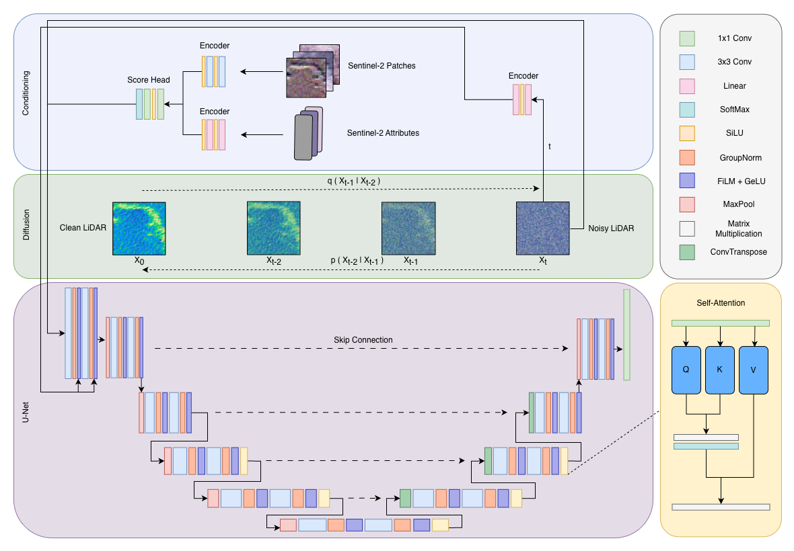
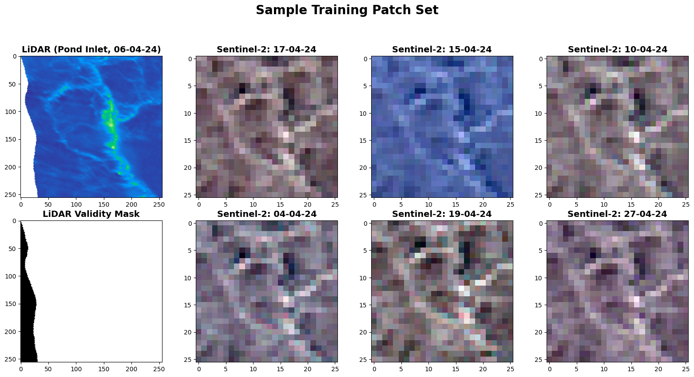

# RoughNet: Generative Super-Resolution of Arctic Sea Ice Roughness from Satellite Imagery

RoughNet is a conditional diffusion model that generates 1 m sea-ice roughness
fields from six collocated, multi-temporal Sentinel-2 images at 10 m resolution.
The targets are **locally demeaned LiDAR residuals**: both the regional elevation
trend and each patch's valid-pixel mean have been removed. Recovering absolute
elevation requires those components or an equivalent reference. The output grid
has 10 times finer linear spacing and 100 times the pixel density of the input.



The repository includes training, evaluation and roughness analysis code,
figures, portable split assignments, and one paired LiDAR/Sentinel-2 sample.
The full prepared dataset, trained checkpoints and evaluation caches are not
included in Git. Full-study commands below require those inputs. The
deterministic U-Net baseline in the paper is being contributed separately.

## Data sources and upstream LiDAR processing

Airborne LiDAR was collected and processed by the Alfred Wegener Institute
IceBird team, including Christian Haas and Veit Helm, during the 2024 winter
campaign. The data are publicly available from
[Helm et al. (2026), PANGAEA](https://doi.org/10.1594/PANGAEA.995793), as cited
in the manuscript. Survey dates were 26 April 2024 for Pond Inlet,
16 April 2024 for Tuktoyaktuk, and 18 April 2024 for Cambridge Bay.

As described in the paper, a RIEGL LMS VQ-580 scanner mounted on a Basler BT67
aircraft collected the observations. Raw returns were combined with
post-processed GNSS trajectories and corrected for aircraft altitude and
calibration angles to produce georeferenced point clouds. A 1 m DEM was
derived by inverse distance weighting with a 5 m search radius.

For RoughNet, coordinates were projected into a local Transverse Mercator
system and a regional quadratic surface was fitted using RANSAC with a
linear-regression estimator. Residuals were computed relative to this surface;
iceberg polygons, unreliable scan areas and residuals outside ±10 m were
excluded. These LiDAR processing steps precede the dataset preparation
included here; their implementation is outside this repository. The public
LiDAR archive and the prepared RoughNet training patches are distinct products.

Optical data come from the
[ESA Copernicus Data Space Ecosystem](https://dataspace.copernicus.eu/).
The study uses six manually screened Sentinel-2 Level-2A products per region
within ±14 days of the LiDAR survey. The four 10 m bands are blue (B2), green
(B3), red (B4) and near-infrared (B8). Stored tensors use R, G, B, NIR order.
Acquisition date, cloud cover and solar/viewing geometry supply metadata.

## Dataset preparation

[data_collocation.ipynb](notebooks/data_collocation.ipynb) queries, inspects
and downloads Sentinel-2 products. It imports `username` and `password` from a
local, ignored `copernicus_login.py`; supply this file locally and keep
credentials out of notebooks and version control.

[patching.ipynb](notebooks/patching.ipynb) extracts paired patches from prepared
LiDAR residuals and Sentinel-2 products. The study uses 256 × 256 LiDAR pixels
at 1 m spacing, a 128-pixel stride, and six corresponding 26 × 26 optical
windows at 10 m spacing. Patches with more than 30% invalid LiDAR pixels are
discarded. LiDAR TIFFs contain residual elevation in band 1 and a binary
validity mask in band 2.

Edit each notebook's configuration for the region, including paths, selected
products, patch ID offsets and zone labels. The patching example currently
targets Tuktoyaktuk. Reusing the committed split IDs requires preserving the
original sample identities and geometry. Footprint-based splitting, described
below, excludes overlapping training neighbours; zone labels alone are
insufficient.

The [dataset loader](src/data/dataset.py) applies these transforms:

- Resize optical views to 256 × 256 using bilinear interpolation. For each
  band, pool all views, clip to the 2nd–98th percentiles and rescale to [0, 1],
  with a minimum intensity range of 1e-3.
- Subtract the LiDAR mean over valid pixels and set invalid targets to zero.
- Apply joint random horizontal/vertical flips and rotations by multiples of
  90° to LiDAR, optical images and masks during training.
- Encode eight attributes per view: cloud fraction; sine/cosine azimuth and
  scaled zenith for solar and viewing geometry; and signed acquisition age
  in days divided by 30.



## Model and paper configuration

RoughNet predicts the clean residual field directly (`x0` prediction). A
shared two-layer CNN encodes each view; an attribute MLP and a
temperature-controlled softmax provide per-pixel weights across views.
Their permutation-invariant weighted sum forms a 24-channel conditioning
map, concatenated with the noisy single-channel residual input. Timestep
embeddings modulate GroupNorm through FiLM in the U-Net blocks.

The encoder/decoder uses double 3 × 3 convolutions, GELU, max pooling,
transposed convolutions and skip connections. Self-attention operates at
the bottleneck and neighbouring stages (`attention_variant: mid`).

| Setting | Paper configuration |
|---|---|
| LiDAR / optical / attribute tensors per sample | `[1, 256, 256]` / `[24, 256, 256]` / `[48]` |
| U-Net depth / base channels / embedding dimension | 4 / 64 / 256 |
| Context | Six views; randomised order during training |
| Optimizer / learning rate | Adam / 1e-4 |
| Batch size / epochs | 8 / 200 |
| Loss | `masked_hybrid_mse_loss`, alpha = 1 |
| Diffusion timesteps | 1,000 |
| Schedule comparison | Separate linear and cosine models |
| Sampler comparison | DDPM, DDIM (eta = 0), PLMS (order = 4); all 1,000 steps |
| Selected configuration | Cosine PLMS, selected on source-region validation |
| Evaluation seed | 42; paired initial noise across configurations and controls |

The implemented loss combines valid-pixel MSE with the mean of horizontal
and vertical gradient MSE. The gradient term uses the whole raster, including
invalid pixels and validity boundaries; see [metrics.py](src/utils/metrics.py).
The checkpoint with the lowest validation loss is retained.

## Repository layout

```text
requirements.txt                 # Runtime dependencies
config.yaml                      # Primary cosine configuration
configs/roughness.yaml            # Roughness analysis and plot settings
metadata/checkpoints.json        # Checkpoint checksums and split compatibility
splits/                          # Paper configurations and portable split IDs
docs/baseline_data_split.md       # Shared split protocol
src/data/                        # Dataset loading and transforms
src/model/                       # Conditional U-Net and fusion
src/diffusion/                   # Schedules and reverse samplers
src/utils/                       # Metrics, split checks and training recovery
scripts/                         # Training, evaluation and analysis
notebooks/                       # Data preparation and visualisation
tests/                           # CPU-compatible unit tests
figures/                         # Final paper figures and provenance
input_data/sample_lidar_patch/    # Tracked example residual and mask
input_data/sample_s2_patch/       # Tracked six-view example and metadata
```

Full data, checkpoints and study outputs are stored locally under
`input_data/`, `models/` and `reconstructions/` and ignored by Git, apart
from the already tracked samples. The commands below identify the paper workflow.

## Installation and sample loading

Run commands from the repository root, containing `scripts/` and `src/`.
Study launchers use Linux, Bash and `flock`. Training and diffusion evaluation
use a CUDA-capable PyTorch environment; metric, baseline and cached roughness
analyses can run on CPU. Local launchers were set up with Python 3.13.
The runtime requirements pin PyTorch 2.7.0 and the core dependencies. The
original environment freeze is retained in `environment/paper-requirements.txt`.

```bash
git clone https://github.com/tessacannon48/RoughNet.git
cd RoughNet
python3 -m venv .venv
source .venv/bin/activate
# CPU installation for tests, sample loading and statistics:
python -m pip install torch==2.7.0 torchvision==0.22.0 --index-url https://download.pytorch.org/whl/cpu
python -m pip install -r requirements.txt
export MPLBACKEND=Agg
export MPLCONFIGDIR=/tmp/roughnet-mpl
```

For GPU training/evaluation, install the same torch/torchvision versions from
`https://download.pytorch.org/whl/cu126` instead of the CPU index before installing
the runtime requirements. Use `requirements-notebooks.txt` for Jupyter/data
preparation and `requirements-dev.txt` for citation validation. The file in `src/`
redirects to the single runtime specification.

Load the included sample without a checkpoint or full dataset:

```python
from src.data.dataset import LidarS2Dataset

dataset = LidarS2Dataset(
    lidar_dirs="input_data/sample_lidar_patch",
    s2_dirs="input_data/sample_s2_patch",
    context_k=6,
    randomize_context=False,
    augment=False,
    split="test",
)
sample = dataset[0]
for key in ("lidar", "mask", "s2", "attrs"):
    print(key, tuple(sample[key].shape))
```

Expected shapes are `(1, 256, 256)`, `(256, 256)`, `(24, 256, 256)` and
`(48,)`. Full training requires the complete paired dataset.

## Spatial splits and training

The full-study layout is:

```text
input_data/
  lidar_patches_<region>/lidar_patch_<id>.tif
  s2_patches_<region>/s2_patch_<id>/
    t0.tif ... t5.tif
    attrs.json
    region.json
```

Region keys are `pondinlet`, `tuk` and `cambridge`. Preserve zero-padded
patch IDs as strings. With full data for all three regions, prepare the
local footprint manifests:

```bash
python scripts/prepare_spatial_splits.py
```

This prepares the primary and alternate folds, local full manifests,
portable ID assignments and cosine configurations. The generated
`roughnet_linear.yaml` uses the primary split with linear noise.
Training patches whose combined LiDAR and six-view Sentinel-2 footprints
overlap validation footprints are excluded.

| Configuration | Training regions | Training | Validation | Held-out test |
|---|---|---:|---:|---|
| `roughnet_cosine` | Pond Inlet + Tuktoyaktuk | 11,076 | 1,290 | Cambridge Bay: 2,111 |
| `roughnet_linear` | Pond Inlet + Tuktoyaktuk | 11,076 | 1,290 | Cambridge Bay: 2,111 |
| `roughnet_cosine_tuk_heldout` | Pond Inlet + Cambridge Bay | 11,589 | 1,333 | Tuktoyaktuk: 1,676 |

Primary validation contains 1,122 Pond Inlet and 168 Tuktoyaktuk patches.
Alternate validation contains 1,122 Pond Inlet and 211 Cambridge Bay patches.
The primary split excludes 507 overlapping neighbours. See the
[baseline split guide](docs/baseline_data_split.md),
[primary IDs](splits/train_val_split_ids.json) and
[alternate IDs](splits/tuk_heldout_clean_ids.json).

Portable manifests (`splits/*_portable.json`) verify input contents with SHA-256
and bind them to split membership and geometry. They work with copied data whose
timestamps differ. Use `--data-root /path/to/input_data` with preparation, training
or evaluation preparation. Historical timestamp-based inventories remain
unchanged. The checkpoint registry in `metadata/checkpoints.json` binds the original
checkpoints to the portable inventories by their exact file checksums; membership alone is insufficient.

Train the three paper models using explicit configuration paths:

```bash
WANDB_MODE=disabled python -u scripts/train_roughnet.py --config splits/roughnet_cosine.yaml --resume
WANDB_MODE=disabled python -u scripts/train_roughnet.py --config splits/roughnet_linear.yaml --resume
WANDB_MODE=disabled python -u scripts/train_roughnet.py --config splits/roughnet_cosine_tuk_heldout.yaml --resume
```

Bare `python scripts/train_roughnet.py` selects the audited primary cosine
configuration. Training without a split manifest is rejected outside explicit
debug mode. The commands above disable W&B uploads. `--resume` starts a new run if no latest checkpoint
exists and otherwise restores the last completed epoch, optimizer and RNG
state. Keep configuration, inputs and split unchanged when resuming.

Best checkpoints are `models/<configuration>/<configuration>_best.pth`;
`_latest.pth` holds recovery state. The wrapper adds locking and logging:

```bash
bash scripts/train_roughnet.sh cosine
bash scripts/train_roughnet.sh linear
bash scripts/train_roughnet.sh cosine_tuk_heldout
```

The checkpoint names are `roughnet_cosine_best.pth`, `roughnet_linear_best.pth`
and `roughnet_cosine_tuk_heldout_best.pth`. The selected epochs are 166, 93 and 134.
Checkpoint checksums and split compatibility are recorded in
[metadata/checkpoints.json](metadata/checkpoints.json).

## Evaluation and baselines

Launchers prepare a study when its manifest is absent, verify completed
batches, skip them on restart and summarize complete results. They default
to the active `python`; to select another interpreter, set:

```bash
export PYTHON_BIN="$VIRTUAL_ENV/bin/python"
```

### Noise schedule, sampler and geographic transfer

With both primary checkpoints and the full split manifest available, run
validation first and freeze the choice before evaluating Cambridge Bay:

```bash
bash scripts/run_noise_sampler_ablation.sh validation
bash scripts/run_noise_sampler_ablation.sh test
```

Outputs under `reconstructions/roughnet_noise_sampler/{validation,test}/` are
`comparison.csv`, `comparison.json`, `comparison.md` and `per_patch.csv`.
The eight metrics are RMSE, signed bias, RMS-height error, normal angle error,
ZNCC, multi-scale JSD, log-PSD RMSE and RMSE normalised by LiDAR standard
deviation. Metrics are computed per patch on valid LiDAR support; reported
standard deviations use the population convention.

The study's pooled validation summary weights patches equally. The paper-table
exporter computes equal-region averages and mean ranks from the regional inputs.
Supplementary Table S1 reports Cambridge Bay test results. Historical measured
results remain under the original `*_clean` study directories and are read-only;
new inference uses the distinct directories above.

Evaluate the alternate model with the frozen cosine PLMS setting:

```bash
bash scripts/run_alternate_fold_evaluation.sh test
```

Results are in `reconstructions/roughnet_tuk_transfer/test/` for all
1,676 Tuktoyaktuk patches; the wrapper also accepts `validation`.
For the shared 168-patch comparison in Supplementary Table S2, restrict
alternate test `per_patch.csv` to the primary Tuktoyaktuk validation IDs
and compare with primary-model validation results.

### Conditioning ablation

```bash
bash scripts/run_corrected_conditioning_ablation.sh
```

The primary cosine checkpoint is evaluated with normal, shuffled and null
conditioning using PLMS, all 1,000 steps and seed 42. Shuffling moves all six
images and attributes together through a one-to-one within-region,
within-split permutation; donors are at least 512 m away without footprint
overlap. Null conditioning zeros images and attributes. This is an
inference-time control, rather than a trained unconditional model.

`reconstructions/roughnet_conditioning/` contains summary/per-patch
CSVs, paired deltas, a LaTeX table and float32 prediction archives. Use this
corrected launcher; generic conditioning preparation retains historical defaults.

### Image-free empirical baseline

```bash
bash scripts/run_image_free_baseline.sh
```

This CPU baseline assigns each Cambridge Bay target one training residual
patch, drawn uniformly with replacement using NumPy PCG64 seed 42. Donors
are the 8,400 fully observed, finite training patches. Selection uses donor
validity and does not match target imagery, elevations or location. Donors
are demeaned on their own support and scored on each target's validity mask.
Preparation requires the primary split manifest and completed primary
noise/sampler reference study.

Outputs in `reconstructions/roughnet_image_free/` include the donor
audit, assignments, score shards, `test/per_patch.csv` and
`test/comparison.{csv,json,md}`, including RoughNet reference results.
Retain donors and assignments to reconstruct baseline predictions.

### Provenance and recovery

Retain complete study directories, including manifests, runtime records,
prediction archives and score shards. Inputs, checkpoints, source files,
batch settings and recorded software/GPU runtime are verified on resume.
Source edits, including dataset changes, can invalidate compatibility with
historical studies. Preserve the paper's source snapshot and use a new
study directory for changed inputs/runtimes; retain historical provenance.

## Roughness analysis and figures

The [roughness configuration](configs/roughness.yaml) selects scored cosine PLMS
caches. It defaults to the original paper study at
`reconstructions/noise_sampler_clean/`; for newly generated results, set
`sets.corrected.study` to `reconstructions/roughnet_noise_sampler/`. Once the
selected study is complete:

```bash
bash scripts/run_roughness_analysis.sh
```

This runs resumable CPU analysis and plotting on all 3,401 validation/test
patches. `ROUGHNESS_WORKERS` sets worker count (default 2). Individual stages are:

```bash
python scripts/roughness_analysis.py prepare
OMP_NUM_THREADS=1 python scripts/roughness_analysis.py run --workers 2
python scripts/roughness_analysis.py summarize
python scripts/plot_roughness.py --out reconstructions/roughnet_roughness
```

New statistics and fit records go to `reconstructions/roughnet_roughness/`.
Analysis covers RMS height, Lin's concordance and Spearman correlation,
exponential variograms with a 200 m maximum lag, centred 1 m distribution
JSD, and Normal, Skew-Normal, Gamma and Log-Normal fits. Roughness classes
use RMS-height thresholds of 5, 10 and 20 cm. Single-scale JSD here differs
from the multi-scale evaluation metric. Failed, upper-bound and
beyond-observed-lag fits are identified. Plot styling can be changed in
`configs/roughness.yaml` without changing frozen analysis settings.
To plot an existing completed analysis, pass its directory with `--out`.

Regenerate regional mosaics from the completed cosine PLMS caches on CPU:

```bash
python scripts/evaluation.py --region tuk --mosaics-only
python scripts/evaluation.py --region pondinlet --mosaics-only
python scripts/evaluation.py --region cambridge --mosaics-only
```

These commands require caches, the matching checkpoint and LiDAR grids;
they do not sample again. Images and provenance JSONs go to
`figures/`. Mosaics blend patch-wise residuals on valid LiDAR
support. Ground truth and predictions share a ±0.5 m symmetric-log scale;
errors use a linear ±0.5 m scale. These are residual mosaics, not absolute
regional elevation maps.

[patch_inference.ipynb](notebooks/patch_inference.ipynb) contains illustrative
patch reconstruction and conditioning-ablation plots, using the primary
checkpoint and local prepared data/caches.

All 11 final manuscript figures are stored directly in `figures/`, using the
filenames from the paper. [The figure inventory](figures/manifest.json) records
their SHA-256 checksums. The single-patch, regional roughness and regional
structure figures also have PDF versions and JSON provenance records.

| Paper figure | File |
|---|---|
| Main 1: regional map | [lidar_map.pdf](figures/lidar_map.pdf) |
| Main 2: model | [model_diagram.png](figures/model_diagram.png) |
| Main 3: patch reconstructions | [patch_reconstructions_pdfs.png](figures/patch_reconstructions_pdfs.png) |
| Main 4: Tuktoyaktuk mosaic | [mosaics_tuk.png](figures/mosaics_tuk.png) |
| Main 5: single-patch analysis | [single_patch_analysis.png](figures/single_patch_analysis.png) |
| Main 6: regional roughness | [patch_wise_roughness.png](figures/patch_wise_roughness.png) |
| Supplement S1: conditioning examples | [condition_ablation_patch_reconstructions.png](figures/condition_ablation_patch_reconstructions.png) |
| Supplement S2: Pond Inlet mosaic | [mosaics_pond.png](figures/mosaics_pond.png) |
| Supplement S3: Cambridge Bay mosaic | [mosaics_cambridge.png](figures/mosaics_cambridge.png) |
| Supplement S4: structure statistics | [patch_wise_structure.png](figures/patch_wise_structure.png) |
| Supplement S5: sample | [sample_patch.png](figures/sample_patch.png) |

## Reproduce the paper tables and verify checkpoints

The CPU table exporter reads measured per-patch results and produces CSV, JSON
and LaTeX for main Tables 1–2 and Supplementary Tables S1–S2. It computes
equal-region averages and mean ranks from unrounded values and verifies the
exact shared 168-patch Tuktoyaktuk cohort.

```bash
python scripts/export_paper_tables.py --allow-incomplete
python scripts/verify_checkpoint.py --smoke-inference
python scripts/verify_checkpoint.py --verify-data --data-root /path/to/input_data
```

The exporter uses the original measured study directories by default; use
`--results-root` to point to an extracted results archive. Without
`--allow-incomplete`, it requires `--unet-results` with the deterministic U-Net's
Cambridge Bay per-patch metrics. Draft tables explicitly identify the missing
baseline row. Generated tables are stored in `results/paper/`.

Checkpoint verification checks the file checksum and its recorded split
identity. `--verify-data` checks a prepared dataset against the portable content
inventory. `--smoke-inference` runs a bounded single forward pass on the included
sample; it does not run full diffusion sampling. These commands require the
corresponding checkpoint and, for full data verification, its prepared inventory.

## Tests and interpretation

Run the CPU-compatible unit suite from the repository root:

```bash
WANDB_MODE=disabled python -m unittest discover -s tests -v
```

Tests cover split exclusions, training recovery, paired noise, conditioning,
baseline scoring, cache integrity, mosaics and roughness analysis. They do
not replace full dataset/inference reproduction.

The paper evaluates two geographic training configurations. Transfer depends
on the terrain represented in training, and performance on held-out Tuktoyaktuk
is poor. Good roughness amplitude/distribution agreement does not establish
correct placement of individual surface features. The model has not been
validated as an operational navigation or ice-safety tool.

## Authors and contact

Software creators: **Tessa Cannon, Michel Tsamados and Weibin Chen**.

Paper authors: Tessa Cannon, Michel Tsamados, Petru Manescu, Thomas Newman, Christian Haas,
Veit Helm, Weibin Chen and Randall Scharien.

Correspondence: [Tessa Cannon](mailto:tessacannon48@gmail.com).
